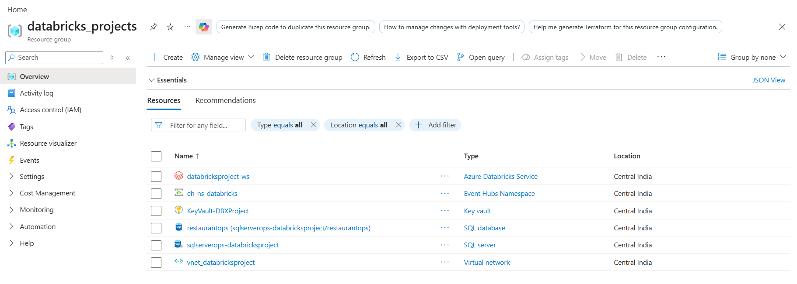
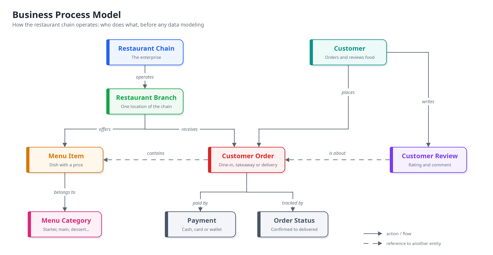
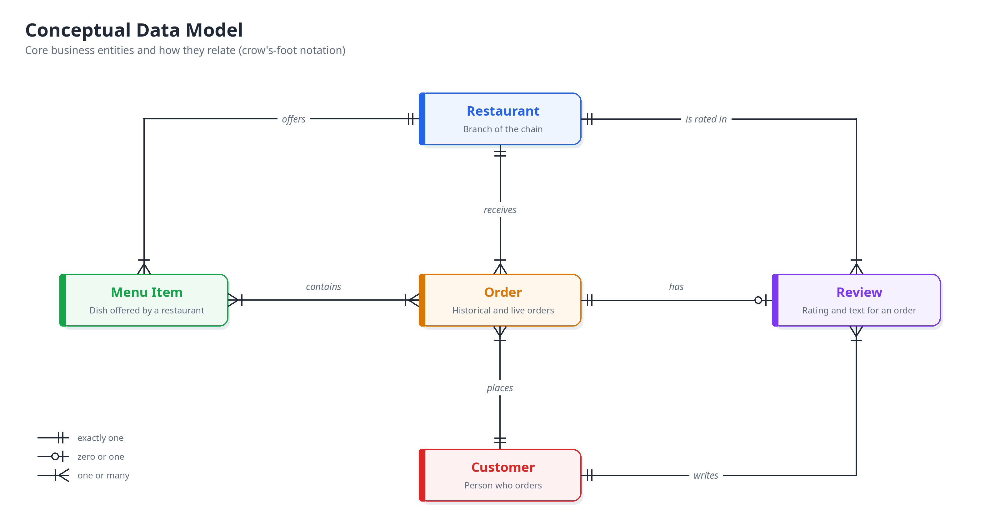
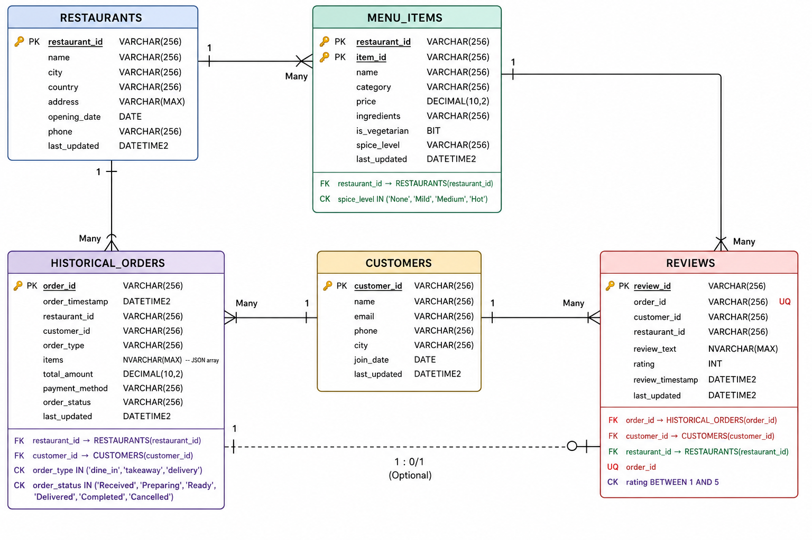
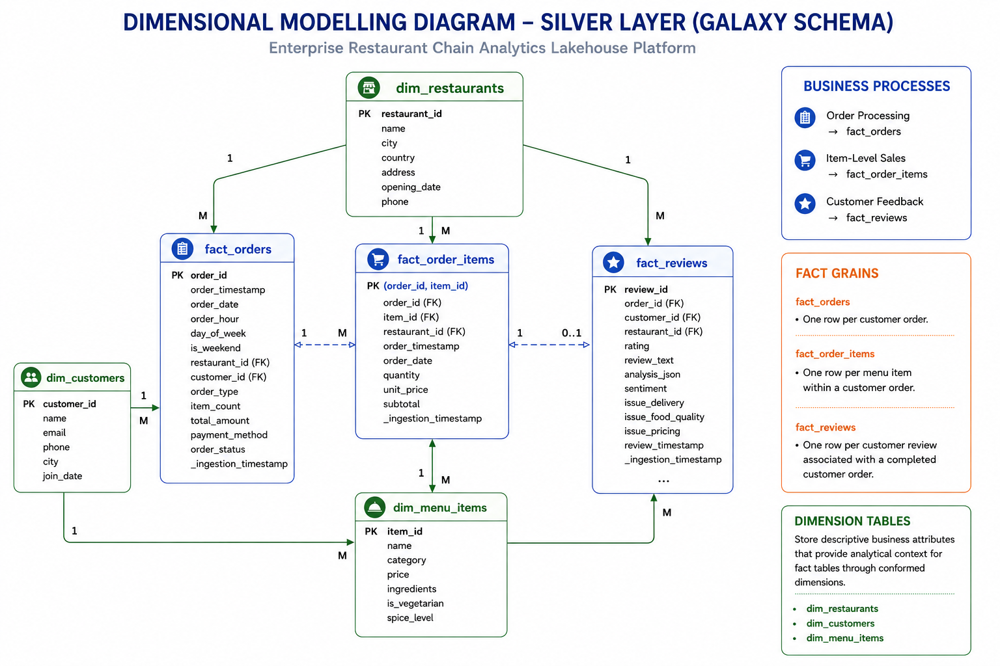
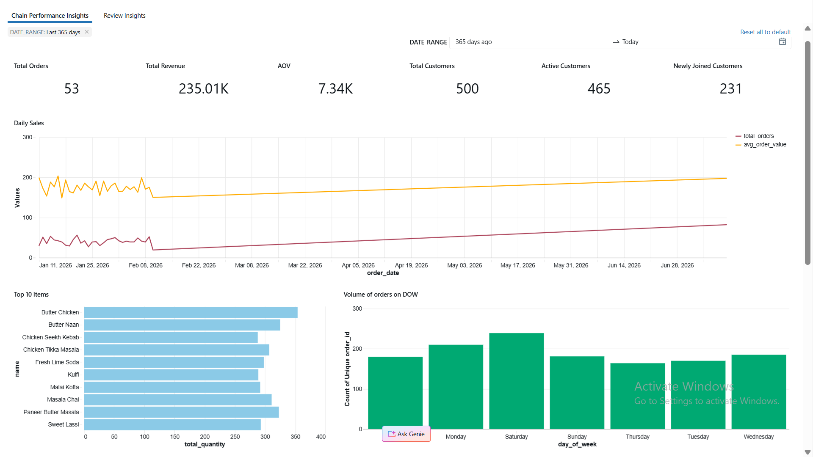
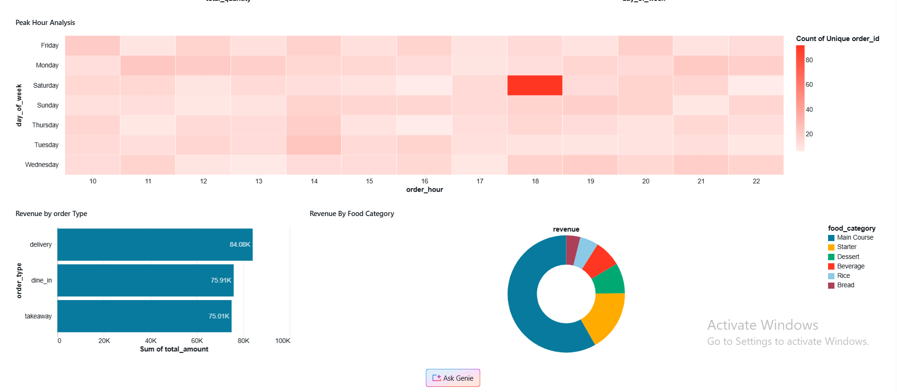
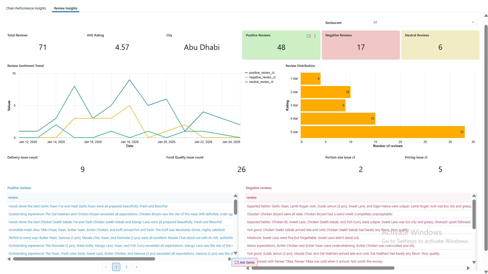

<div align="center">

# 🍽️ Enterprise Restaurant Chain Analytics Lakehouse Platform

**End-to-end Azure Databricks Lakehouse: batch + streaming ingestion, Medallion architecture, governed analytics**


[Architecture](#architecture) •
[Data modeling](#data-modeling) •
[Medallion](#medallion) •
[Governance](#governance) •
[Dashboards](#dashboards) •
[Getting started](#getting-started)

</div>

---

## 📌 Overview

An end-to-end **Azure Databricks Lakehouse** for a restaurant chain. It combines historical data from **Azure SQL Database** with live orders from **Azure Event Hubs**, processes them through **Bronze → Silver → Gold** layers, and serves dashboards, Genie and governed KPIs.

| | Highlights |
|---|---|
| ⚡ | Batch and streaming ingestion |
| 🧱 | Kimball galaxy schema with SCD Type 2 dimensions |
| ✅ | Data-quality quarantine and alerts |
| 🤖 | LLM review analysis |
| 📊 | Metric views with shared KPI definitions |
| 🔐 | Unity Catalog governance |
| 🚀 | Deployment as code with GitHub Actions CI/CD |

---

<a id="architecture"></a>

## 🏗️ Architecture

<p align="center">
  
</p>

1. **Ingest:** Lakeflow Connect loads Azure SQL tables incrementally, and a Spark Declarative Pipeline streams orders from Event Hubs.
2. **Transform:** Silver cleans, validates and models the data. Gold builds business-ready datasets.
3. **Serve:** AI/BI dashboards, Genie and metric views read from Gold.
4. **Run:** one Lakeflow job runs the whole flow every hour.

---

## 🧰 Technology stack

| Area | Technology |
|---|---|
| Platform | Azure Databricks (serverless), Delta Lake, ADLS Gen2 |
| Sources | Azure SQL Database, Azure Event Hubs |
| Pipelines | Lakeflow Connect, Spark Declarative Pipelines, PySpark, SQL |
| AI | `ai_query` with a Databricks-hosted LLM |
| Governance | Unity Catalog |
| Analytics | AI/BI dashboards, Genie, metric views |
| Delivery | Lakeflow Jobs, Databricks Asset Bundles, GitHub Actions |

<p align="center">
  
</p>

---

<a id="data-modeling"></a>

## 🧩 Data modeling

The model was designed in four steps, from business process to analytical schema.

**1. Business process:** how restaurants, customers, menu items, orders, reviews and payments interact.

<p align="center">

</p>

**2. Conceptual model:** the core entities and their relationships.

<p align="center">

</p>

**3. ER model (OLTP):** the normalized (3NF) Azure SQL source schema.

<p align="center">

</p>

**4. Dimensional model (OLAP):** a Kimball galaxy schema, in which three fact tables share three dimensions.

<p align="center">

</p>

| Facts | Dimensions (SCD Type 2) |
|---|---|
| `fact_orders`: historical and live orders in one table | `dim_restaurants` |
| `fact_order_items`: one row per ordered item | `dim_customers` |
| `fact_reviews`: reviews with AI sentiment and issue flags | `dim_menu_items` |

---

<a id="medallion"></a>

## 🥉🥈🥇 Medallion architecture

| Layer | Schema | What it does |
|---|---|---|
| **Bronze** | `01_bronze` | Raw copies of the SQL tables and the Event Hubs order stream |
| **Silver** | `02_silver` | Cleans and validates data, keeps dimension history (SCD2), merges historical and live orders, analyzes reviews with an LLM |
| **Gold** | `03_gold` | `d_sales_summary` (daily KPIs), `daily_customer_360` (customer profiles), `d_restaurant_reviews` (review analytics), plus metric views |

> [!NOTE]
> **AI review analysis:** for each review, an LLM returns the sentiment and flags issues with delivery, food quality, pricing or portion size.

---

## ✅ Data quality

- **Rules:** every order and order item is checked against rules such as required keys, positive amounts and valid status.
- **Only valid rows reach the fact tables.**
- **Quarantine:** failed rows are saved in `*_quarantine` tables, with the names of the rules they broke.
- **Alerts:** a `dq_alert` task emails a summary when rows are quarantined.

---

## 📊 Semantic layer

Unity Catalog **metric views** define each KPI once. Dashboards, Genie and SQL then all calculate it the same way.

| Metric view | Measures |
|---|---|
| `mv_sales` | orders, revenue, average order value, unique customers, items sold |
| `mv_menu` | quantity sold, item revenue, average unit price |
| `mv_reviews` | review count, average rating, sentiment share, issue counts |

```sql
SELECT restaurant_name, MEASURE(total_revenue), MEASURE(avg_order_value)
FROM databricksproject_ws.`03_gold`.mv_sales
GROUP BY restaurant_name;
```

---

<a id="governance"></a>

## 🔐 Governance and security

| Role | Sees |
|---|---|
| **Owner** | All data, all restaurants, PII visible |
| **Data Engineering** | All layers; PII masked in Gold |
| **Analytics** | Gold and secure views only; assigned restaurants only; PII masked |

- **RBAC:** access is granted per role and per schema.
- **Restaurant-level isolation:**
  - A mapping table lists which restaurants each user may see.
  - Row filters, dynamic views and metric views apply that list.
- **PII protection:**
  - Customer name, email and phone columns are tagged `pii`.
  - An ABAC policy masks every tagged column for everyone except owners.
  - Masking functions partially hide emails and phone numbers.

---

## 🔄 Orchestration and CI/CD

**Hourly job (`master_job`):**

```text
governance setup → ingestion (SQL + Event Hubs) → Silver → Gold + DQ alert → metric views → governance apply
```

Each run processes only new data, and a failure sends an email.

**Deployment:**
- Everything is defined as a Databricks Asset Bundle, with separate `dev` and `prod` targets.
- GitHub Actions validates every pull request and deploys to prod on merge to `master`.

---

<a id="dashboards"></a>

## 📈 Dashboards

**Chain performance:** revenue, orders, average order value, customer growth, top items and weekday trends.

<p align="center">

</p>

<p align="center">

</p>

**Review insights:** sentiment trends, rating distribution, top complaint categories and the latest reviews. Genie is enabled for natural-language questions.

<p align="center">

</p>

---

## 📁 Repository structure

```text
├── .github/workflows/              # CI/CD
├── 00_synthetic_data/              # Source schemas, data generators, sample CSVs
├── 01_pipelines/                   # Copy of the pipeline code, by layer
├── DeclarativeAutomationBundles/   # Deployable Databricks Asset Bundle
│   ├── databricks.yml              # Variables and dev/prod targets
│   ├── resources/                  # Pipelines, job, dashboard
│   └── sources/                    # Pipeline code, dashboard, governance, DQ, metric views
├── Documents/                      # Workflow and Kafka/Event Hubs notes
└── diagrams/                       # Images used in this README
```

---

<a id="getting-started"></a>

## 🚀 Getting started

> [!IMPORTANT]
> Complete the one-time workspace setup in [`prerequisites.md`](./DeclarativeAutomationBundles/prerequisites.md) first: SQL connection, secret scope, catalog, access groups and the `pii` tag.

```bash
# 1. Generate sample data (8,000 orders over 6 months) and load it into Azure SQL
cd 00_synthetic_data/2_data_generation_scripts
pip install -r requirements.txt
python 03_run.py

# 2. Optional: stream live orders (needs EVENTHUB_CONNECTION_STRING and EVENTHUB_NAME in .env)
python 04_eventhub_orders.py

# 4. Deploy and run
cd ../../DeclarativeAutomationBundles
databricks bundle deploy --target dev
databricks bundle run master_job --target dev
```

---

## 👥 Contributors

| **Rahul Talari** | **Parimala Sri Sikhakolli** |
|:---:|:---:|

<div align="center">

⭐ If you find this project useful, consider giving it a star.

</div>
